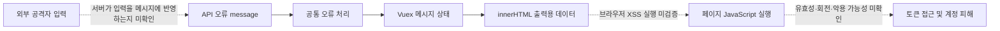

# 외부 침입 가능성 검토 및 3차 점검

점검일: 2026-10-28 (KST)  
대상: `https://www.lina.co.kr` 공개 페이지에서 직접 참조한 JavaScript  
관련: [최초 보고서](report.ko.md), [추가 보고서](report-additional.ko.md)

후속: [최근 금융권 사고 비교](financial-incidents-comparison.ko.md)에서 공식 사고 발표와의 대조 및 인증 헤더 목적지 검사(F-10)를 추가 검토했습니다.

## 현재 판단

**외부 공격자가 서버·관리자·다른 사용자 계정에 무단 접근할 수 있다는 증거는 확보하지 못했습니다. 침입이 불가능하다고 판단할 근거도 부족합니다.**

이번에는 API 오류 응답의 `message`가 상태 저장소를 거쳐 `innerHTML`에 전달되는 경로를 확인하고, 선택한 원본 코드 구간을 합성 데이터로 로컬 재현했습니다. 공격자가 해당 API 메시지 내용을 제어할 수 있다면 XSS 검증 대상이 됩니다. 기존에 확인한 JavaScript 접근 가능 토큰 저장(F-05)과 결합될 경우 계정 피해를 키울 수 있으나, **실제 공격자 입력 → 스크립트 실행 → 유효 토큰 악용의 전체 연결은 입증하지 않았습니다.**

인증·인가·서버 입력 검증·서버 실행 환경은 원본 소스와 테스트 환경 없이 확인하지 못했습니다. 현재 결과로 출시 안전성을 승인하거나 위험도를 하나의 숫자로 표현하지 않습니다. 이미 침해가 발생했는지에 대한 포렌식 판단도 수행하지 않았습니다.

## 이번에 수행한 점검

- 기존 홈 HTML에 직접 참조된 JS 10개를 일반 GET으로 순차 조회했습니다. 기본 6개와 공통 코드 4개이며 총 본문 크기는 **1,042,498 bytes**입니다.
- 요청 간격 최소 1초, 요청별 20초 제한, 파일별 3 MiB/회차별 10 MiB 제한을 적용했습니다. 쿠키·인증정보를 전송하지 않았고, 리다이렉트를 따라가지 않았습니다.
- 포트/디렉터리/취약점 스캔, 임의 경로 추측, source map 요청, 공격 문자열 전송, API 호출, 로그인, 데이터 변경, 다른 계정 접근은 하지 않았습니다.
- 공개 번들의 선택된 원본 구문만 실행했습니다. 합성 응답과 저장소/헬퍼 모형을 사용했으며 전체 앱·브라우저·서버를 실행한 테스트는 아닙니다.
- 서버/API 소스 경로 또는 저장소와 테스트 환경을 요청했습니다. 현재 작업 폴더에는 여전히 원본 애플리케이션 소스가 없습니다.

증적은 `path-evidence/` 및 `path-evidence/common/`에 별도로 보관했습니다. 두 폴더의 P01~P04 이름은 서로 다른 수집 회차이므로 아래에서 전체 상대 경로로 구분합니다. 본문 SHA-256은 각 `responses.json`에 있습니다.

## 침입 시나리오별 평가

| 시나리오 | 확인한 근거 | 아직 필요한 조건/검증 | 현재 판정 |
|---|---|---|---|
| 오류 메시지 기반 XSS → 사용자 계정 피해 | API 오류 메시지 → Vuex 저장 → innerHTML용 데이터 경로; JS 접근 가능 토큰 저장 | 외부 입력의 메시지 반영, 브라우저 코드 실행, 사용자 문맥, 서버 토큰 유효성/방어 정책 | **조건부 위험 경로. 원격 악용 미입증** |
| Axios를 통한 XSRF 값 노출 | 0.21.4 버전 메타데이터 및 교차 출처·withCredentials 조건의 헤더 복사 구문 | 실제 XSRF 쿠키, 해당 호출 옵션, 공격자 제어 목적지, 요청 도달/CORS 조건 | **라이브러리 수준 동작 확인. 앱 악용 미입증** |
| 로그인/접근 권한 우회 | 프런트 코드에 로그인 오류 처리·로그아웃 메서드 호출이 있음 | 서버의 요청별 인증·역할·객체 소유권 검증 | **미확인** |
| SQL injection·파일 업로드·명령 실행을 통한 서버 침투 | 확인된 서버 취약점 근거 없음 | 서버 소스/설정과 격리된 테스트 환경에서의 검증 | **검증하지 못함. 안전 판정 불가** |
| 공개 내부 주소를 통한 내부망 접근 | 내부 서비스 이름/포트 공개(F-04) | 서버 측 요청 유발 기능·내부망 라우팅·접근 제어 우회 | **주소 노출만 확인. 내부 접근 미입증** |
| 제휴/분석 스크립트 침해 → 브라우저 토큰 접근 | 외부 script 로드와 JS 토큰 접근 구조 | 외부 스크립트 침해 또는 권한 오용 자체 | **설계상 영향 검토. 실제 침해 증거 없음** |

다음 그림에서 점선은 확인하지 못한 연결입니다.



## F-07 — API 오류 메시지의 HTML 출력 경로 (기존 F-03의 추가 근거)

분류: **수정 우선순위 높음. HTML 전달 경로는 확인, 원격 XSS는 미확인.** 기존 F-03과 연결된 근거이며 별도의 침입 성공 사례로 중복 집계하지 않습니다.

**근거**

1. `path-evidence/common/P03.js`의 Axios 오류 인터셉터는 `a.response.data`를 `d`에 담고 `d.message`를 `m`에 가져옵니다.
2. 기본 오류 분기에서는 message 필드가 있고 errorCode와 message가 서로 다르면 `m`을 유지합니다. 일부 오류/타임아웃 분기에는 고정 메시지를 사용하지만, 모든 메시지를 인코딩하거나 정화하지는 않습니다.
3. 이어서 `x={message:m,...}`를 만들고 `refreshStore/showMessageState`로 전달합니다.
4. `path-evidence/common/P04.js`의 해당 mutation은 메시지 객체를 상태에 합칩니다. 이 구간에 HTML 정화는 없습니다.
5. 기존 `additional-evidence/A03.js`의 전역 메시지 렌더링은 `domProps:{innerHTML:t._s(t.messageState.messageInfo.message)}`를 사용합니다.

**로컬 검증 결과**

| 합성 API 데이터 | 저장값 및 HTML 출력용 데이터 |
|---|---|
| errorCode=`AUDIT_LOCAL_CODE`, message=`<b data-audit="LOCAL_ONLY">AUDIT_MARKER</b>` | HTML 문자열이 그대로 유지됨 |
| errorCode=`AUDIT_LOCAL_CODE`, message=`일시적인 오류입니다.` | 원문 유지 |
| errorCode와 message가 모두 `AUDIT_IDENTICAL` | 기존 코드의 고정 오류 메시지로 대체됨 |

검토한 원본 초기화/메시지 선택 구문, mutation, 렌더링 데이터 표현식을 분리해 실행했습니다. Babel 속성 복사와 Vue 문자열화는 단순 문자열 입력을 위한 모형을 사용했습니다. 실제 Vue 렌더러를 실행하거나 브라우저 HTML을 파싱하지 않았으며, 이벤트/스크립트·토큰 읽기·유출 코드는 실행하지 않았습니다.

**영향과 남은 불확실성**

외부 사용자의 입력이나 비신뢰 CMS/외부 시스템 데이터가 API 오류의 message로 반영된다면 HTML 삽입 및 XSS 경로가 될 수 있습니다. 그러나 서버가 신뢰된 고정 오류 메시지만 반환한다면 공격자가 그 값을 제어하지 못할 수 있습니다. 테스트용 응답을 임의 구성하는 것만으로 실제 서버의 반사를 입증할 수는 없습니다. [OWASP DOM XSS 방어 지침](https://cheatsheetseries.owasp.org/cheatsheets/DOM_based_XSS_Prevention_Cheat_Sheet.html)

**수정 방법과 참고 코드**

- 전역 일반 메시지를 `innerHTML`/`v-html` 대신 텍스트로 렌더링합니다. 줄바꿈은 `white-space: pre-line`이나 명시적 컴포넌트로 표현합니다. [fixes/PlainMessage.example.vue](fixes/PlainMessage.example.vue)는 통합 참고용이며 실제 앱에서 컴파일하지 않았습니다.
- API 오류는 승인한 errorCode를 고정 안내 문구로 매핑하고, 원본 message/stackTrace를 UI로 전달하지 않습니다. [fixes/public-error-message.mjs](fixes/public-error-message.mjs)에 참고 구현을 작성했습니다. 전체 코드 사전과 업무 메시지는 서버 계약에 맞춰 확장해야 합니다.
- 신뢰된 리치 HTML이 꼭 필요하다면 일반 메시지와 분리하고, 해당 출력 지점에서 검증된 정화 정책을 적용합니다. CSP는 추가 방어층으로 적용합니다.
- 서버에서도 사용자 입력을 오류 메시지에 조합해 반환하는지 검토합니다.

**수정 참고 코드 검증**

`public-error-regression.test.mjs`: **6개 통과, 0 실패**. HTML/합성 비밀값 미반영, 알 수 없는 코드의 고정 fallback, prototype 이름·상속 필드·잘못된 데이터 형식 처리, 정확한 코드 매칭을 확인했습니다. 실제 소스에 통합하거나 서비스를 수정한 것은 아닙니다.

## F-08 — 토큰 갱신 응답의 refresh token을 이전 값으로 덮어쓰기

분류: **인증 수명주기 검토 사항. 서버 정책 확인 전 취약점으로 확정하지 않음.**

**근거**

`path-evidence/common/P03.js`의 특정 401 오류 갱신 경로에서 기존 refresh token을 `O`로 보관하고, 갱신 응답을 받은 뒤 `r.data.refreshToken=O`로 이전 값을 다시 대입합니다. 이후 `authStore/setTokenInfo`에 `r.data`를 전달합니다.

**로컬 검증 결과**

갱신 응답에 합성 새 토큰 `AUDIT_FAKE_NEW_REFRESH`, 이전 값에 `AUDIT_FAKE_PREVIOUS_REFRESH`를 넣었습니다. 실제 대입 구문 실행 후 선택된 값은 이전 토큰이었습니다. 서버에 갱신 요청을 보내지 않았고, 실제 토큰은 사용하지 않았습니다.

**영향**

서버가 refresh token을 회전하고 새 값을 응답한다면 클라이언트가 이를 버려 이후 갱신 실패·재사용 탐지와 충돌할 수 있습니다. 서버가 기존 토큰 재사용을 계약으로 허용하는 구조라면 의도된 동작일 수도 있습니다. 이것만으로 서버에서 토큰 회전이 없거나 공격자가 오래된 토큰을 재사용할 수 있다고 판단하지 않습니다. 이 결과는 앞서 A03에서 확인한 로그인 시간 연장 경로와 별도의 인터셉터 분기입니다.

**수정 방법 및 검증 기준**

- 인증 서버 계약에서 새 refresh token 반환 및 기존 토큰 폐기 정책을 확인합니다.
- 회전 방식이라면 응답의 새 토큰을 보존하고 이전 값으로 덮어쓰지 않도록 수정합니다. 새 토큰 누락/동시 갱신/재사용 탐지 시 처리를 명시합니다.
- 비회전 방식이면 그 정책과 보완 통제(유효기간, 폐기, 바인딩 등)를 문서화하고 서버와 클라이언트가 일치하는지 검증합니다.
- 테스트 환경에서 새 토큰 채택, 이전 토큰 거부, 동시 갱신, 새로고침·재로그인·로그아웃 후 폐기를 검증해야 합니다. 원본 인증 계약이 없어 통합 수정/서버 회귀 검사는 하지 못했습니다.

## F-09 — Axios 0.21.4 및 교차 출처 XSRF 헤더 복사 동작

분류: **의존성 개선 필요. 취약 동작 구문은 확인, 실제 앱에서의 악용 조건은 미확인.**

**근거**

- `path-evidence/P01.js`의 번들 패키지 메타데이터에 `"name":"axios","version":"0.21.4"`가 있습니다.
- XHR 어댑터에서 `(t.withCredentials || c(y))` 조건이 참이고 xsrfCookieName이 있으면 쿠키 값을 읽어 xsrfHeaderName의 헤더에 복사하는 구문을 확인했습니다. `c(y)`는 같은 출처 검사입니다.
- Axios 공식 v0.28.0 릴리스는 CVE-2023-45857 수정의 0.x 백포트를 설명하며, 공식 수정 PR에는 교차 출처에서 withCredentials만으로 XSRF 헤더를 보내던 동작의 수정이 포함됩니다. [공식 0.x 수정 릴리스](https://github.com/axios/axios/releases/tag/v0.28.0), [공식 수정 PR](https://github.com/axios/axios/pull/6028)

**로컬 검증 결과**

동일 출처 검사와 쿠키 읽기를 모형으로 제공하고, 원본 XSRF 복사 구문만 실행했습니다. 실제 네트워크 객체는 제공하지 않았습니다.

| 같은 출처 | withCredentials | 합성 XSRF 헤더 복사 |
|---|---|---|
| 아니오 | true | 발생 |
| 아니오 | false | 없음 |
| 예 | false | 발생 |

**영향과 한계**

공격자 제어 목적지로 호출하는 경로, withCredentials 설정, 실제 XSRF 쿠키가 함께 존재하면 의도하지 않은 출처로 XSRF 값이 전달될 위험이 있습니다. 실제 요청은 브라우저의 preflight/CORS 및 호출 경로에도 영향을 받습니다. 현재 공개 비인증 응답에서 XSRF 쿠키는 확인하지 않았고, 검토한 공통 Axios 인스턴스 생성 코드에서 withCredentials:true 기본 설정도 확인하지 못했습니다. 다른 호출부 설정·공격자 목적지 제어 가능성은 미확인입니다.

클라이언트 번들의 버전만으로 서버 측 Axios 버전이나 SSRF/RCE 가능성을 추정하지 않습니다. 별도 백포트 여부도 전체 배포 이력 없이 확정할 수 없으나, 이번에는 버전 문자열 외에 해당 문제의 처리 구문도 확인했습니다.

**수정 방법과 검증 기준**

- 현재 유지 관리되며 관련 공식 보안 권고를 반영한 버전으로 호환성 검증 후 교체합니다. v0.28.0/v1.6.0은 이 개별 취약점의 과거 수정 기준이며 현재 모든 권고를 반영한 권장 버전이라는 뜻이 아닙니다.
- 인증/XSRF 헤더를 보낼 목적지를 정확한 origin 허용 목록으로 제한합니다. 전역 withCredentials 설정과 절대 URL 입력 경로를 점검합니다.
- 로컬 모의 전송 테스트에서 허용 API에 필요한 헤더만 전달되고 다른 origin에는 민감 헤더가 없는지 확인합니다. 실제 서비스로 토큰을 보내 시험하지 않습니다.
- 잠금 파일과 원본 의존성 트리가 없어 실제 의존성 수정 및 전체 회귀 검사는 하지 못했습니다.

## 기존 판단을 보완하는 정상·제한 사항

- 로그아웃 클라이언트 코드에 `getMemberLogout()` 서버 메서드 호출이 존재합니다. 따라서 로그아웃이 클라이언트 저장소 삭제만 수행한다고 판단하지 않습니다. 서버가 토큰을 실제로 폐기하는지는 여전히 미확인입니다.
- 일부 인증 오류에서는 토큰 상태를 비우고 로그인으로 전환하는 분기를 확인했습니다. 이는 서버의 모든 인증/권한 검사나 우회 불가능성을 보증하지 않습니다.
- 검토한 오류 처리/표시 코드에는 production/staging에서 txId/stackTrace의 UI 노출을 제한하는 분기가 있습니다. 원래 API 응답 자체가 내부 정보를 반환하는지는 API를 조회하지 않아 확인하지 않았습니다.
- TLS 1.3·HSTS 등 기존 정상 관측은 사용자/서버 침입 가능성을 단독으로 배제하지 않습니다.

## 우선 수정 및 실제 침입 검증의 다음 단계

1. **먼저 줄일 수 있는 경로:** 공통 메시지 텍스트 출력/고정 코드 매핑, 구버전 jQuery·Axios 정리, 프레임/CSP 정책, 불필요한 공개 내부 설정·raw query 저장 제거. 현재는 로컬 참고 코드만 준비한 상태입니다.
2. **다음으로 확인할 인증 통제:** 서버 토큰 회전 계약과 F-08의 일치, 로그인/로그아웃/만료 후 거부, refresh 재사용 탐지. 전용 계정과 합성 데이터를 사용하는 테스트 환경이 필요합니다.
3. **권한·서버 침투 가능성:** 서버/API 소스·라우트·배포/프록시/업로드 설정을 검토하고, 테스트 계정 A/B로 객체 소유권 및 역할 권한을 검증합니다. 권한 검사는 브라우저 UI가 아니라 서버의 매 요청에서 확인해야 합니다. [OWASP 인가 지침](https://cheatsheetseries.owasp.org/cheatsheets/Authorization_Cheat_Sheet.html)
4. **실제 XSS 성립 여부:** 서버 오류 메시지의 입력 조합 지점을 추적하고 격리 테스트에서 먼저 비실행 마커의 왕복을 확인합니다. 실제 고객 세션·운영 데이터로 시험하지 않습니다.

필요 자료는 서버/프런트 원본 소스 경로 또는 저장소, 잠금 파일, 민감값을 제거한 배포/환경 설정, 실제 테스트 환경 주소와 전용 계정/합성 데이터입니다. 추가 도메인의 API를 검증할 경우 그 대상 범위도 먼저 확인해야 합니다. 운영 설정 변경이나 영향 있는 검증은 구체적인 변경·영향·복구 방법을 정리해 먼저 알리고 진행해야 합니다.

## 재현 및 산출물

```powershell
# 네트워크 없이 저장된 코드와 합성 값만 사용
node audit/verify-intrusion-paths.mjs
node --test audit/tests/public-error-regression.test.mjs
```

- 상세 로컬 결과/실행 구문/문자열 offset: `path-evidence/local-path-verification.json`.
- 이번 수집 파일 10개의 SHA-256 확인 완료.
- API 메시지 처리 3가지, 토큰 덮어쓰기 1가지, XSRF 조건 3가지를 로컬 재현.
- 새 오류 메시지 참고 코드의 회귀 테스트 **6개 통과**. 이전 10개·8개 테스트 결과는 각각 앞선 보고서에 있으며 이번 수정 예시로 실제 서비스가 바뀐 것은 아닙니다.
- `collect-path-review.mjs`는 온라인 증적 수집용입니다. 재현/회귀 검사에는 실행할 필요가 없습니다. 기존 증적이 있으면 같은 회차를 덮어쓰지 않도록 중지합니다.
